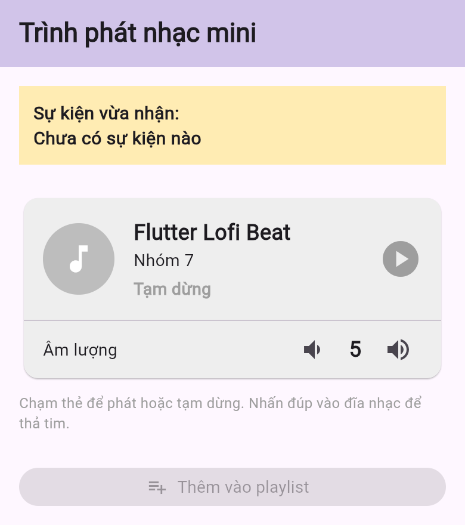
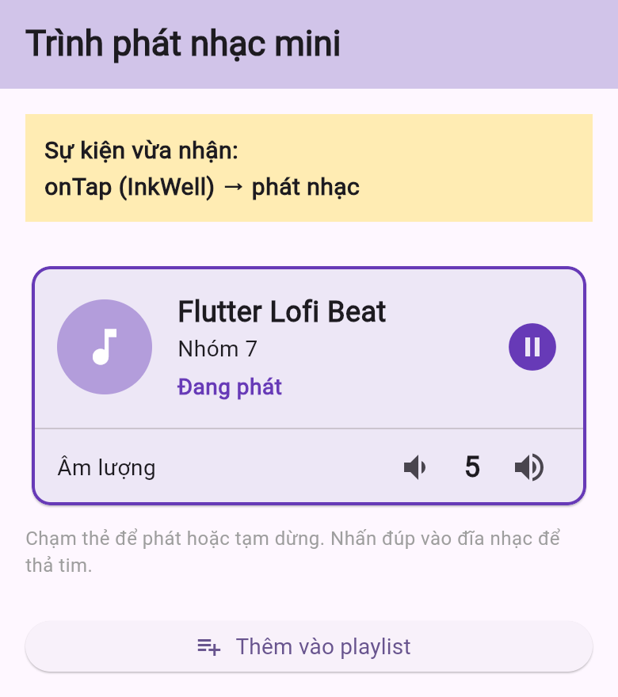
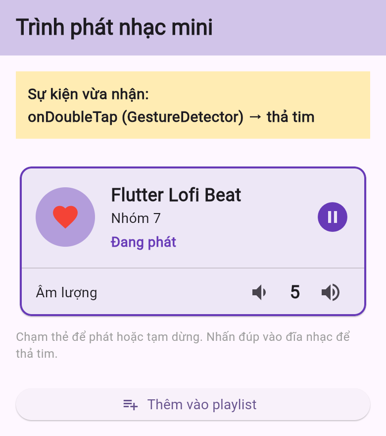
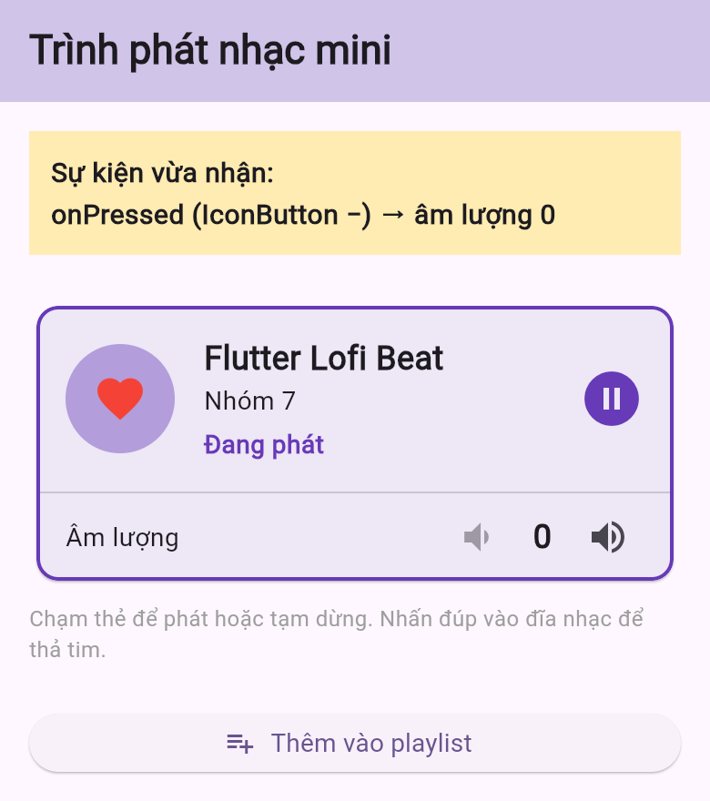
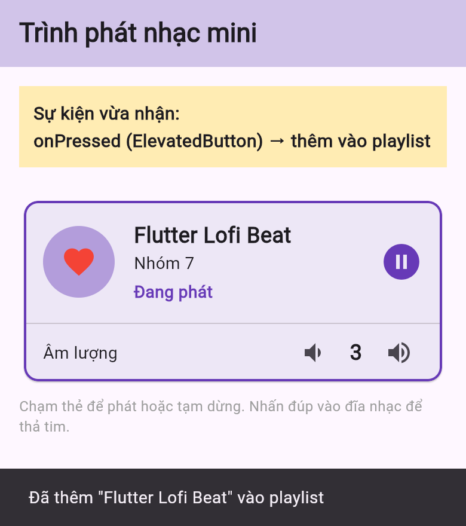

# Demo Chủ đề 7 – Sự kiện và tương tác người dùng trong giao diện

Ứng dụng **Trình phát nhạc mini** viết bằng Flutter, minh họa:

- Callback, `onPressed`, `onTap`, `GestureDetector` và `InkWell`
- Phân biệt sự kiện tương tác với nơi lưu giữ trạng thái
- Cập nhật giao diện bằng `setState` và phản hồi khi người dùng thao tác

Nhóm thực hiện: Nguyễn Thái Hoàng (106230011), Lê Trương Uyển Nhi (106230054).

## Cấu trúc mã nguồn

```
lib/
├── main.dart                  # Khởi chạy ứng dụng
├── models/song.dart           # Dữ liệu cố định của bài hát
├── pages/player_page.dart     # Nơi giữ trạng thái, xử lý sự kiện bằng setState
└── widgets/song_card.dart     # Thẻ bài hát: nhận thao tác, báo lên qua callback
test/
├── song_card_test.dart        # Kiểm thử callback của SongCard
└── player_page_test.dart      # Kiểm thử luồng sự kiện -> trạng thái -> giao diện
```

| File | Người phụ trách |
|---|---|
| `lib/models/song.dart`, `lib/pages/player_page.dart`, `lib/main.dart`, `test/player_page_test.dart` | Lê Trương Uyển Nhi |
| `lib/widgets/song_card.dart`, `test/song_card_test.dart`, `README.md` | Nguyễn Thái Hoàng |

## Luồng tương tác

| Thao tác | Widget · sự kiện | Trạng thái thay đổi | Kết quả trên giao diện |
|---|---|---|---|
| Chạm vào thẻ bài hát | `InkWell` · `onTap` | `_isPlaying` đảo giá trị | Thẻ viền tím, hiện “Đang phát”, nút playlist mở khóa |
| Nhấn đúp vào đĩa nhạc | `GestureDetector` · `onDoubleTap` | `_isFavorite` đảo giá trị | Đĩa nhạc chuyển thành trái tim |
| Bấm nút − / + | `IconButton` · `onPressed` | `_volume` tăng/giảm 1, từ 0 đến 10 | Số âm lượng đổi, nút mờ khi chạm 0 hoặc 10 |
| Bấm “Thêm vào playlist” | `ElevatedButton` · `onPressed` | `_lastEvent` | SnackBar xác nhận |

Thanh **“Sự kiện vừa nhận”** ở đầu màn hình ghi tên widget và sự kiện vừa được gọi sau mỗi thao tác.

## Chạy ứng dụng

```bash
cd demo
flutter pub get
flutter run -d chrome      # hoặc: flutter run -d windows / máy ảo Android
```

Chạy kiểm thử:

```bash
flutter test
```

## Kịch bản demo

1. Chạm vào thẻ bài hát: thanh sự kiện ghi `onTap (InkWell) → phát nhạc`, thẻ chuyển sang trạng thái đang phát.
2. Nhấn đúp vào đĩa nhạc: thanh sự kiện ghi `onDoubleTap (GestureDetector) → thả tim`, không có gợn sóng.
3. Bấm nút − đến khi âm lượng bằng 0: nút − tự mờ vì `onPressed` nhận `null`.
4. Tăng âm lượng rồi bấm “Thêm vào playlist”: SnackBar hiện ở cuối màn hình.

| Ban đầu | Bước 1 | Bước 2 | Bước 3 | Bước 4 |
|---|---|---|---|---|
|  |  |  |  |  |
